<p><picture>
  <source media="(prefers-color-scheme: dark)" srcset="imagenes/readme/portada-oscuro.svg">
  
</picture></p>

<p align="center">
  
  
  
  
  
</p>

Un curso para llevar un modelo del notebook a producción en Azure, escrito como el de [LangGraph](https://github.com/B3njjaman/LangGraph): cada concepto se presenta como una definición, sus propiedades y el código que lo implementa. Todo el curso sigue un mismo proyecto: el pronóstico diario del consumo eléctrico de una planta industrial, que crece módulo a módulo hasta tener pipeline, registro, despliegue y monitoreo. El último módulo pasa a LLMOps, con un agente en producción.

La planta es simulada a propósito. Como se conoce el proceso que genera sus datos, se puede dejar que el tiempo avance y medir cuánto se equivoca cada modelo en días que nunca vio. Las lecciones corren en Colab o en Kaggle, en CPU y sin claves; cada una termina mostrando cómo se ve en Azure Machine Learning lo que construyó.

## La ruta

<p><picture>
  <source media="(prefers-color-scheme: dark)" srcset="imagenes/readme/ruta-oscuro.svg">
  
</picture></p>

Cada módulo usa lo del anterior. El 1 convierte el modelo de un notebook en código que se puede repetir, evaluar y probar; el 2 registra cada entrenamiento y decide qué modelo pasa a producción; el 3 lo convierte en un pipeline de Azure ML; el 4 lo sirve cada mañana; el 5 automatiza el camino con CI/CD; el 6 vigila que siga sirviendo, y el 7 lleva las mismas ideas a un agente con un modelo de lenguaje.

## La promesa y la realidad

El módulo 1 parte de un modelo escrito como en casi cualquier notebook: features, una partición al azar y un random forest.

```python
X_ent, X_pru, y_ent, y_pru = train_test_split(X, y, test_size=0.2, random_state=0)
modelo = RandomForestRegressor(n_estimators=200, random_state=0).fit(X_ent, y_ent)
mean_absolute_error(y_pru, modelo.predict(X_pru))   # 6,10 MWh: lo que promete el notebook
```

Después la planta vive 2026, y cada mañana a las 06:00 el modelo pronostica con lo que existe a esa hora. Se equivoca en 8,99 MWh, casi un 50 % más de lo prometido. El error de prueba $\widehat R_P(f)$ estima sin sesgo el riesgo $R(f)$ cuando los días de prueba son independientes de los de entrenamiento y se parecen a los días en que se usará el modelo; en una serie de tiempo partida al azar no se cumple ninguna de las dos cosas. El módulo encuentra cuatro fallas detrás de esa brecha, y dedica una lección a cada una.

## Módulos

### Módulo 1 · Del notebook al código reproducible

<p><picture>
  <source media="(prefers-color-scheme: dark)" srcset="imagenes/readme/modulo-1-oscuro.svg">
  
</picture></p>

| Lección | Qué construye |
|---|---|
| 1 · [Un modelo en un notebook](modulos/modulo-1/01_un_modelo_en_un_notebook.ipynb) | El contrato del pronóstico, la planta simulada y el modelo del notebook. La planta vive 2026 y aparecen cuatro fallas: no se repite, la partición al azar mira el futuro, usa datos que no existen a las 06:00 y nada lo prueba |
| 2 · [Reproducibilidad](modulos/modulo-1/02_reproducibilidad.ipynb) | El entrenamiento como función de cuatro entradas: datos, configuración, semillas y entorno. Fija cada una y las deja en una ficha que viaja con el modelo, con la huella de los datos y las versiones. De paso muestra que el orden de las filas cambia el modelo. En Azure, *environments* y *data assets* con versión |
| 3 · [Validación temporal](modulos/modulo-1/03_validacion_temporal.ipynb) | Qué es un esquema de validación, cuándo respeta el tiempo y cuánto futuro deja ver. Mide cuatro esquemas con la planta frente al error real de 2026, demuestra por qué interpolar es más fácil que pronosticar, separa la validación de la prueba y presenta el backtesting de origen móvil. En Azure, el backtest como paso del pipeline, seguido de una compuerta |
| 4 · [Training-serving skew](modulos/modulo-1/04_training_serving_skew.ipynb) | Una sola función de features, que solo usa lo que existe a las 06:00 y se guarda junto al modelo. Una prueba comprueba que, para los 365 días de 2026, las features calculadas en lote y día por día son las mismas. Agrega un contrato para las solicitudes, y en Azure el script de scoring importa la misma función |
| 5 · [Probar un sistema de ML](modulos/modulo-1/05_probar_un_sistema_de_ml.ipynb) | Pruebas automáticas con pytest para los datos, las features y el modelo, más una compuerta que decide si un modelo nuevo reemplaza al anterior. Atrapan el consumo que llega en kWh y el día que falta. Al final las lleva a un repositorio mínimo que corre en cada pull request, y en Azure al paso `validar` del pipeline |

Índice del módulo: [`modulos/modulo-1`](modulos/modulo-1).

### Módulo 2 · Experimentos y registro con MLflow

<p><picture>
  <source media="(prefers-color-scheme: dark)" srcset="imagenes/readme/modulo-2-oscuro.svg">
  
</picture></p>

Por escribir. Cada entrenamiento como una corrida de MLflow, el registro de modelos con versiones y alias, y la compuerta que decide si el candidato reemplaza al campeón.

### Módulo 3 · Pipelines de entrenamiento en Azure ML

<p><picture>
  <source media="(prefers-color-scheme: dark)" srcset="imagenes/readme/modulo-3-oscuro.svg">
  
</picture></p>

Por escribir. Jobs, components y pipelines de Azure ML, environments y data assets con versión, y la promoción entre ambientes.

### Módulo 4 · Servir el modelo: online y batch

<p><picture>
  <source media="(prefers-color-scheme: dark)" srcset="imagenes/readme/modulo-4-oscuro.svg">
  
</picture></p>

Por escribir. Cuándo un pronóstico se sirve en línea y cuándo por lotes, managed online endpoints, batch endpoints y de dónde sale la latencia.

### Módulo 5 · CI, CD y CT: lanzar sin miedo

<p><picture>
  <source media="(prefers-color-scheme: dark)" srcset="imagenes/readme/modulo-5-oscuro.svg">
  
</picture></p>

Por escribir. GitHub Actions con Azure por OIDC, reentrenamiento continuo, despliegues blue/green y canary, y qué tiene que estar listo para volver atrás.

### Módulo 6 · Monitoreo y drift

<p><picture>
  <source media="(prefers-color-scheme: dark)" srcset="imagenes/readme/modulo-6-oscuro.svg">
  
</picture></p>

Por escribir. Las capas del monitoreo, cómo se mide el drift (PSI, Kolmogorov-Smirnov), la verdad que llega al día siguiente y cuándo reentrenar.

### Módulo 7 · LLMOps: agentes en producción

<p><picture>
  <source media="(prefers-color-scheme: dark)" srcset="imagenes/readme/modulo-7-oscuro.svg">
  
</picture></p>

Por escribir. Modelos de Azure OpenAI en Foundry, el gateway, evaluación offline y en línea, trazas, costos y un agente de LangGraph en producción.

## Simulaciones

Las ideas que se entienden mejor viéndolas correr tienen una simulación en el navegador, en [Complementarios](https://b3njjaman.github.io/MLOps-en-Azure/complementarios/). Cada una sigue una lección, con la matemática y el código al lado, y su lógica está probada contra scikit-learn. Con el repositorio en el PC también se abren sin servidor, desde `complementarios/index.html`.

| Simulación | Dónde y qué muestra |
|---|---|
| [Validación temporal](https://b3njjaman.github.io/MLOps-en-Azure/complementarios/validacion.html) | Módulo 1, lección 3 · La historia de la planta partida al azar, en un holdout temporal, con origen móvil y con ventana deslizante: los pliegues, la fuga y lo que promete cada esquema frente al error real de 2026 |
| Despliegue canary<br><sub>próximamente</sub> | Módulo 5 · Cómo se reparte el tráfico entre dos versiones y cuándo se vuelve atrás |
| Drift y PSI<br><sub>próximamente</sub> | Módulo 6 · Dos distribuciones que se separan y el índice que lo mide |

Cómo están hechas y cómo se prueban: [`complementarios/`](complementarios).

## Cómo ejecutarlo

**En Colab**, la forma más directa: cada lección tiene un botón «Open in Colab» al comienzo. La primera celda descarga el simulador de la planta, y lo demás ya viene en Colab.

**En Kaggle:** en [kaggle.com](https://www.kaggle.com), **Create → New Notebook** y después **File → Import Notebook**, con la dirección del notebook en GitHub; por ejemplo, `https://github.com/B3njjaman/MLOps-en-Azure/blob/main/modulos/modulo-1/01_un_modelo_en_un_notebook.ipynb`. La primera celda descarga el simulador, así que necesita **Internet on** en **Settings**.

**En el PC**, desde la raíz del repositorio, en Windows (PowerShell):

```powershell
git clone https://github.com/B3njjaman/MLOps-en-Azure.git
cd MLOps-en-Azure
python -m venv .venv
.\.venv\Scripts\Activate.ps1
pip install -r modulos/requirements.txt
jupyter notebook
```

En macOS o Linux:

```bash
git clone https://github.com/B3njjaman/MLOps-en-Azure.git
cd MLOps-en-Azure
python3 -m venv .venv
source .venv/bin/activate
pip install -r modulos/requirements.txt
jupyter notebook
```

Ninguna lección del módulo 1 necesita una suscripción de Azure: las secciones «En Azure» muestran los YAML y los comandos, revisados contra la documentación oficial, sin ejecutarlos.

## Imágenes

Todas siguen el modo claro u oscuro del navegador y se generan con código:

- los diagramas de las lecciones, en [D2](https://d2lang.com): `python imagenes/diagramas/generar.py modulo-1`;
- las imágenes animadas de este README: `python imagenes/readme/generar.py`, que solo usa la biblioteca estándar.

Los diagramas se cargan desde GitHub Pages para que también se vean en Colab y en Kaggle.

## Estructura

```
MLOps-en-Azure/
├── modulos/                 el curso, una carpeta por módulo
│   ├── modulo-1/            las lecciones en notebooks, el simulador de la planta y el índice
│   └── requirements.txt
├── complementarios/         las simulaciones (GitHub Pages) y sus pruebas contra scikit-learn
├── imagenes/
│   ├── diagramas/           diagramas en D2 y su generador
│   └── readme/              las imágenes animadas de este README y su generador
└── README.md
```

## Fuentes

Los conceptos y la sintaxis de Azure siguen la documentación oficial de [Azure Machine Learning](https://learn.microsoft.com/azure/machine-learning/) en Microsoft Learn, y la de [scikit-learn](https://scikit-learn.org/stable/). El texto, el código, la planta simulada y las imágenes son propios. No está afiliado a Microsoft.
