# Módulo 1 · Del notebook al código reproducible

Proyecto del módulo: el pronóstico diario del consumo eléctrico de una planta industrial. Parte como un modelo escrito en un notebook, que promete un error de 6,1 MWh y en 2026 entrega 9,0, y termina como código que se puede repetir, que se evalúa como se usa, que calcula sus features igual al entrenar y al pronosticar, y que tiene pruebas automáticas.

Cada concepto se presenta como definición, propiedad y código, con diagramas animados y gráficos de la planta.



| Lección | Qué construye | Colab |
|---|---|---|
| [1 · Un modelo en un notebook](01_un_modelo_en_un_notebook.ipynb) | El contrato del pronóstico, la planta simulada y el modelo del notebook. La planta vive 2026 y aparecen cuatro fallas: no se repite, la partición al azar mira el futuro, usa datos que no existen a las 06:00 y nada lo prueba | [](https://colab.research.google.com/github/B3njjaman/MLOps-en-Azure/blob/main/modulos/modulo-1/01_un_modelo_en_un_notebook.ipynb) |
| [2 · Reproducibilidad](02_reproducibilidad.ipynb) | El entrenamiento como función de datos, configuración, semillas y entorno, y la ficha que deja constancia de cada uno. En Azure, *environments* y *data assets* con versión | [](https://colab.research.google.com/github/B3njjaman/MLOps-en-Azure/blob/main/modulos/modulo-1/02_reproducibilidad.ipynb) |
| [3 · Validación temporal](03_validacion_temporal.ipynb) | Esquemas de validación que respetan el tiempo, el backtesting de origen móvil y la separación entre validación y prueba, medidos frente al error real de 2026. En Azure, el backtest como paso del pipeline | [](https://colab.research.google.com/github/B3njjaman/MLOps-en-Azure/blob/main/modulos/modulo-1/03_validacion_temporal.ipynb) |
| [4 · Training-serving skew](04_training_serving_skew.ipynb) | Una sola función de features, causal y guardada junto al modelo, la prueba de que en lote y a las 06:00 da lo mismo, y el contrato de entrada. En Azure, el script de scoring que la importa | [](https://colab.research.google.com/github/B3njjaman/MLOps-en-Azure/blob/main/modulos/modulo-1/04_training_serving_skew.ipynb) |
| [5 · Probar un sistema de ML](05_probar_un_sistema_de_ml.ipynb) | Pruebas de datos, de features y del modelo con pytest, y una compuerta para reemplazar el modelo. En Azure, las pruebas en cada pull request y el paso `validar` del pipeline | [](https://colab.research.google.com/github/B3njjaman/MLOps-en-Azure/blob/main/modulos/modulo-1/05_probar_un_sistema_de_ml.ipynb) |

**Simulación.** La lección 3 tiene una en el navegador: [Validación temporal](https://b3njjaman.github.io/MLOps-en-Azure/complementarios/validacion.html), con la historia de la planta partida de cuatro formas y lo que promete cada una frente al error real de 2026.

## La planta

[`planta.py`](planta.py) simula la planta día a día con un proceso conocido: la producción planificada, la temperatura y su pronóstico, y el consumo, que depende de la producción, del clima, del desgaste de los equipos y de un ruido con memoria. `historia()` entrega 2022 a 2025, para entrenar; `futuro()` entrega 2026, para ver qué pasa después. La lección 1 presenta sus ecuaciones (Definición 1.3). Solo usa numpy y pandas, y la misma semilla da siempre los mismos datos.

## Cómo ejecutar las lecciones

**En Colab o Kaggle**, con el botón de cada lección o importando el notebook desde GitHub. La primera celda de cada lección descarga `planta.py`, así que en Kaggle hay que activar **Internet on** en **Settings**. No necesitan GPU ni claves.

**En el PC**, desde la raíz del repositorio:

```bash
python -m venv .venv
.venv\Scripts\activate          # en macOS o Linux: source .venv/bin/activate
pip install -r modulos/requirements.txt
jupyter notebook
```

Los diagramas se cargan desde GitHub Pages, así que se ven en cualquiera de los tres lugares si hay internet.

## Imágenes

Los diagramas se escriben en [D2](https://d2lang.com) (fuentes en [`imagenes/diagramas/fuentes/modulo-1/`](../../imagenes/diagramas/fuentes/modulo-1/)) y siguen el modo claro u oscuro del navegador. Para regenerarlos, desde la raíz:

```bash
python imagenes/diagramas/generar.py modulo-1    # necesita D2 0.9 o más nuevo
```
